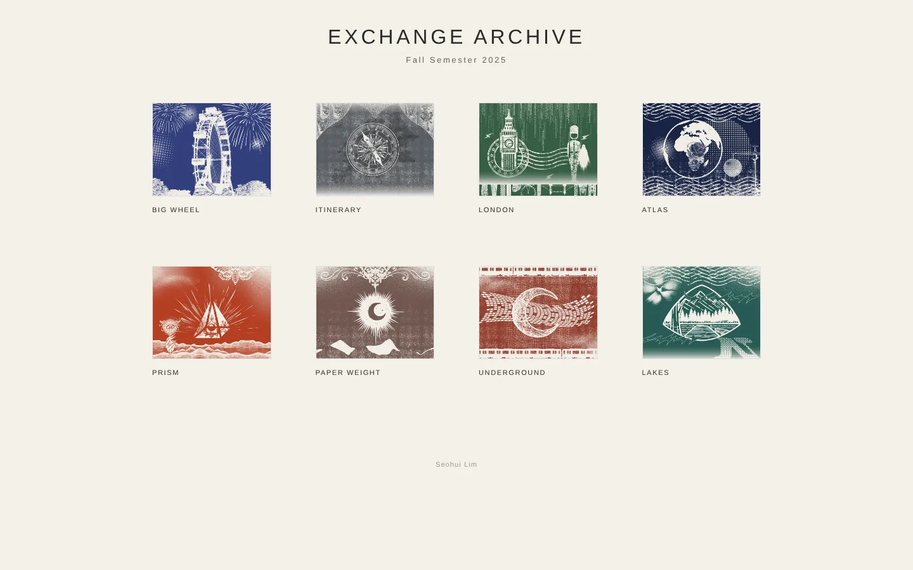
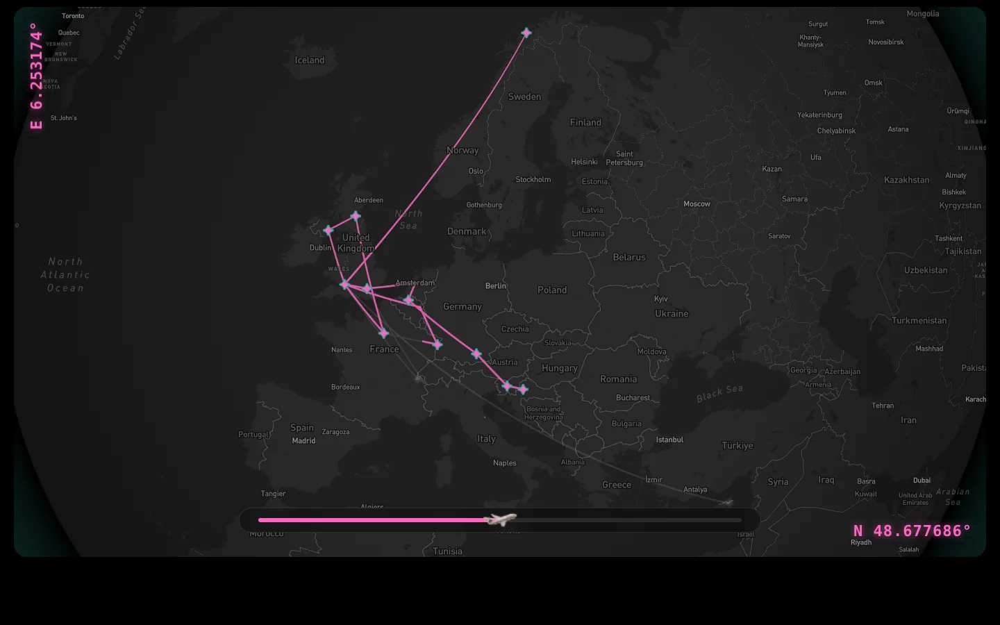
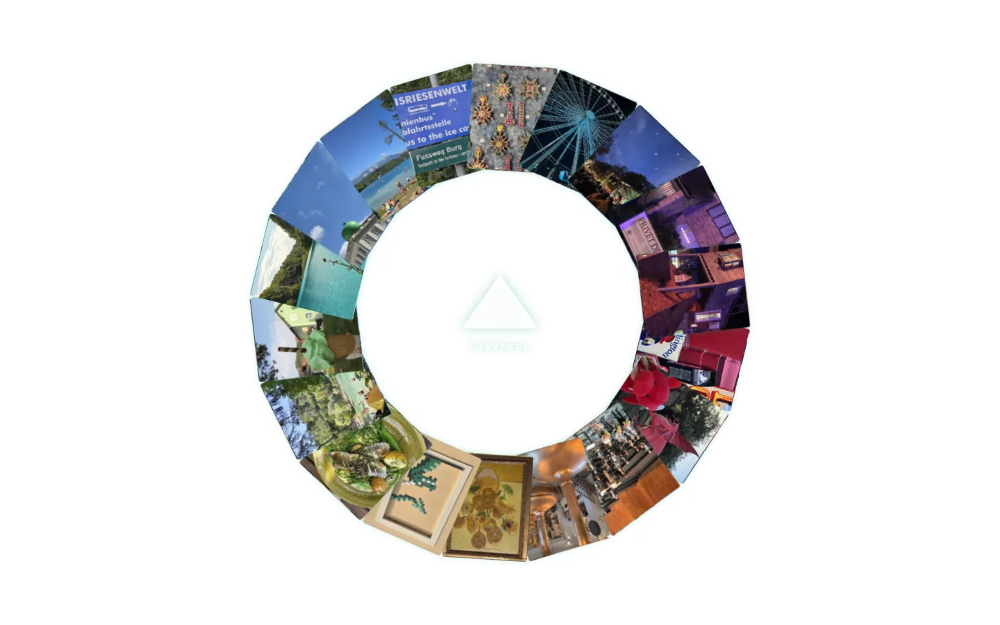

# Exchange Archive 2025

University of Bristol 교환학기(2025.09–12) 동안 다닌 도시·호수·노선을 페이지마다 다른 인터랙션으로 기록한 웹 아카이브입니다.

**Live** → https://makadamianut.github.io/Atlas2025/

| 허브 | Itinerary | Prism |
|---|---|---|
|  |  |  |

## 페이지

| 페이지 | 보여주는 것 |
|---|---|
| [Big Wheel](pages/big-wheel.html) | 다녀간 도시 이름이 관람차처럼 도는 휠 |
| [Itinerary](pages/itinerary.html) | 슬라이더로 비행기를 움직이면 이동 경로가 그려지고 정류지가 켜지는 지구본 지도 |
| [London](pages/london.html) | 커서로 우산을 움직여 근위병을 비에서 지키는 런던 |
| [Atlas](pages/atlas.html) | QGIS로 만든 지도 5장. 클릭하면 제목·투영법·설명이 열림 |
| [Prism](pages/prism.html) | 프리즘을 누르면 사진 18장이 원형으로 펼쳐지고, 사진마다 도시 이름과 색이 바뀜 |
| [Paper Weight](pages/paperweight.html) | 지도 위를 따라다니는 돋보기 렌즈 |
| [Underground](pages/underground.html) | 런던 지하철 노선색으로 만든 깜빡이는 로고와 노선 범례 |
| [Lakes](pages/lakes.html) | 호수 8곳의 실제 윤곽선. 누르면 사진과 좌표·날짜 |

`pages/bounce-ball.html`(픽셀 테마 고도 바운스)은 실험 페이지라 허브에는 연결하지 않았습니다.

## 데이터 흐름

```
QGIS 3.40에서 경로(LineString)·정류지(Point 22곳, 10개국) 작성
  → GeoJSON(CRS84)으로 내보내기          data/route.geojson, data/stops.geojson
  → Mapbox GL JS로 지구본 위에 표시
  → Turf.js로 슬라이더 위치만큼 경로를 잘라 그리고(lineSliceAlong),
    정류지를 경로에 스냅해(nearestPointOnLine) 지나간 곳을 켬
```

`data/*.qmd`는 QGIS 레이어 스타일 파일입니다. Atlas의 지도들은 QGIS에서 각 지역에 맞는 투영법(EPSG:3035, 27700, 3413)으로 제작했습니다.

## 기술

HTML · CSS · JavaScript, [GSAP](https://gsap.com/), [Mapbox GL JS](https://docs.mapbox.com/mapbox-gl-js/), [Turf.js](https://turfjs.org/), QGIS, GitHub Pages

## 구조

```
index.html        허브
pages/            각 페이지
assets/img/       사진·지도 (WebP, 긴 변 2000px 이하, EXIF 제거)
assets/thumb/     허브 썸네일
data/             GeoJSON, QGIS 스타일
docs/screenshots/ README용 스크린샷
```

## 로컬에서 보기

Itinerary가 `fetch`로 GeoJSON을 읽기 때문에 파일을 더블클릭(file://)하면 지도가 비어 보입니다. 간단한 서버로 여세요.

```bash
python -m http.server 8000
# http://localhost:8000
```

Itinerary의 Mapbox 토큰은 공개용(pk.) 토큰이며, Mapbox 계정에서 배포 도메인으로 사용 URL을 제한해 두었습니다. 다른 도메인에서 띄우려면 자신의 토큰으로 바꿔야 합니다.

## 정비 기록 (2026.11)

- 파일명을 소문자-하이픈으로 통일하고 폴더를 나눔 (대소문자를 구분하는 GitHub Pages 대응)
- 이미지를 WebP로 바꾸고 표시 크기에 맞게 줄임. 사진의 촬영 위치(GPS) 정보 제거

  | 페이지 | 이전 | 이후 |
  |---|---|---|
  | 허브 썸네일 8장 | 6.0MB | 0.9MB |
  | Prism 사진 18장 | 33.8MB | 0.8MB |
  | Atlas 지도 5장 | 15.3MB | 1.5MB |
  | Lakes 사진 8장 | 17.7MB | 3.8MB |
  | Paper Weight 배경 | 5.4MB | 0.2MB |

- Itinerary 시작 위치에서 나던 Turf 에러, Underground·London의 모바일 가로 넘침 수정

---

Seohui Lim · 기획, 디자인, 개발, 배포
